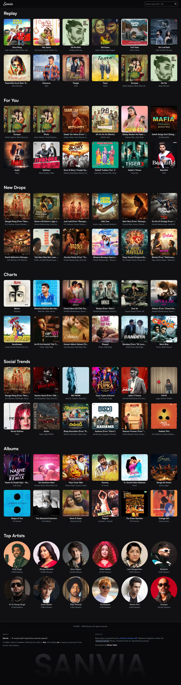
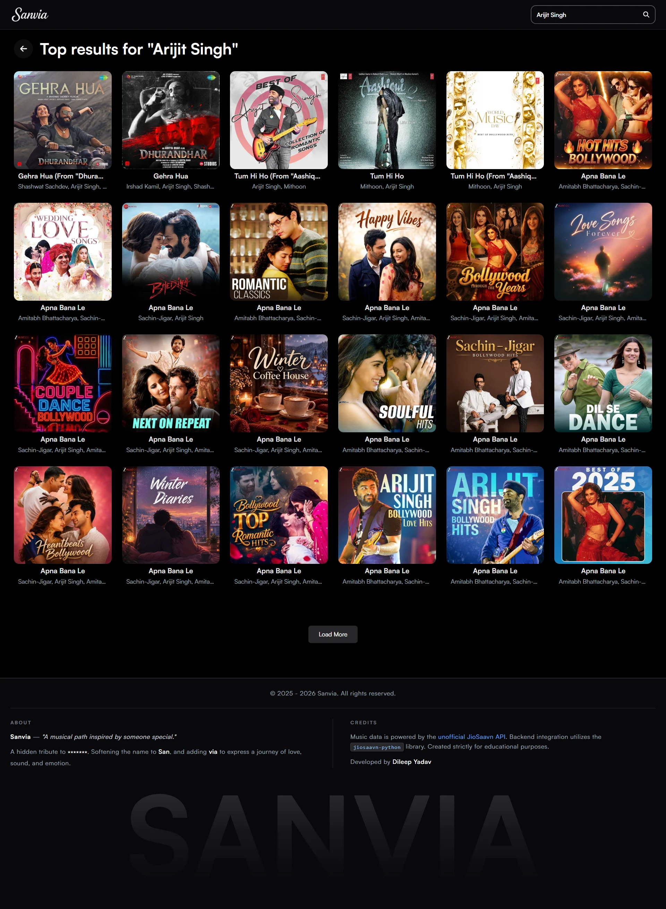
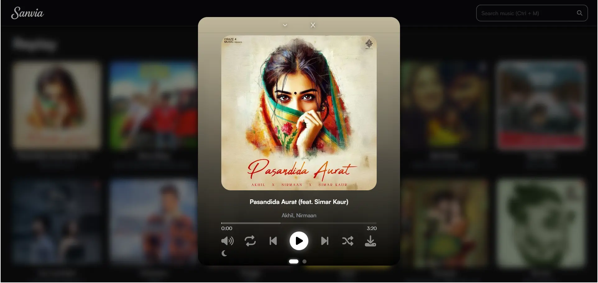
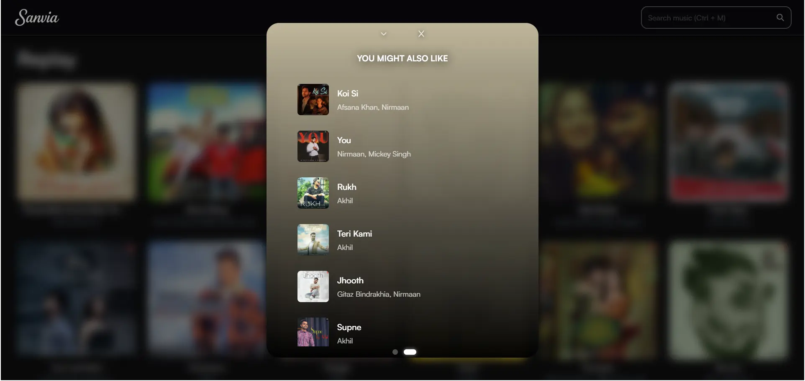

# Sanvia - Music Streaming Web App



**Sanvia** is a sleek, modern, and responsive music streaming web application inspired by JioSaavn. It delivers a smooth, high-performance music experience across small screens (mobile) and large screens (desktop), built using **Next.js 14**, **Tailwind CSS**, and **ShadCN UI**.

> **Sanvia** – "A musical path inspired by someone special."
> A hidden tribute to someone dear. Softening the name to **San**, and adding **via** to express the journey of love, sound, and emotion.

> Powered by the unofficial JioSaavn API.

---

## Overview

Sanvia brings together music discovery, playback, queue management, and offline downloads in one seamless interface. Every view adapts to the device — from a compact mini-player on mobile to a full-screen immersive player on desktop, with touch gestures and keyboard shortcuts tuned for each.

---

## Core Features

### Music Discovery & Search

Browse a dynamic home feed of the latest releases, trending songs, and top albums. Search for tracks, artists, or albums with paginated results that load on demand.



- Dynamic home feed of new releases and trending content
- Search across songs, artists, and albums
- Paginated results with a "Load More" button
- Detailed album pages with instant playback from the track list
- Skeleton loading states so the grid never feels blank

### Interactive Music Player



A persistent bottom player on every page that expands into a full-screen immersive view.

- Play, pause, seek, repeat, shuffle, and mute
- Sleep timer with extend and cancel options
- Offline download directly from the player
- Double-tap the album artwork on touch devices to skip forward or backward by 5 seconds
- Background color dynamically sampled from the album artwork
- Native system media controls on lock screen and hardware keys

### Smart Contextual Views

The expanded player adapts its second view to whatever you're playing:

- **Playing a single song** → Recommended tracks based on genre, artist, and popularity
- **Playing an album** → Full album track list
- **Playing an artist** → Available discography and top songs



Switch between Player, Queue, and Related using the tab toggle at the bottom of the expanded view.

### Queue Management

- Drag-and-drop reordering of upcoming tracks
- Swipe left on a track to add it to the queue
- Swipe right on a track to remove it from the queue
- Currently playing track is auto-scrolled into view when the queue opens
- Queue view hides itself automatically when the queue is empty

### Cross-Platform Context Menus

Access rich options for any track, album, or artist without interrupting playback.

- **Desktop**: Right-click any card or track
- **Mobile**: Long-press any card or track, with haptic feedback where supported
- Default browser right-click menu is suppressed over interactive elements for a native app feel
- Options include: Play next, Add to queue, Remove from queue, Download, and Info (quality, size, duration)
- Album and artist menus can queue the whole collection at once
- Downloads keep running in the background even after the menu closes

### Persistent Background Downloads

- Downloads continue globally regardless of navigation
- Close the context menu or switch views without losing progress
- Duplicate requests for the same track are prevented automatically
- Live percentage synced across the player, menus, and context views in real time
- Cancel button available on the active download from any surface

### Performance Optimizations

- Identical API calls are intercepted and served from cache
- Images retry automatically on transient failures
- Skeleton loaders and progressive image loading keep the UI responsive
- Smooth, hardware-accelerated animations throughout

### Onboarding

First-time users see contextual tooltips explaining the gestures and options available on the current screen. Each tooltip appears once, is scoped to the screen it describes, and can be dismissed with the button or the Escape key.

---

## Keyboard Shortcuts

Sanvia is fully keyboard-driven on desktop.

| Shortcut | Action |
|----------|--------|
| Space | Play / Pause |
| Ctrl + Right Arrow | Next song |
| Ctrl + Left Arrow | Previous song |
| Right Arrow | Forward 5 seconds |
| Left Arrow | Back 5 seconds |
| R | Repeat |
| S | Shuffle |
| M | Mute / Unmute |
| T | Sleep timer |
| Shift + D | Download song |
| Shift + C | Cancel download |
| Ctrl + Up Arrow | Expand player |
| Ctrl + Down Arrow | Collapse player |
| Ctrl + X | Close player |
| Shift + Right Arrow | Next view (Queue/Related) |
| Shift + Left Arrow | Previous view |
| Ctrl + M | Search music |
| Escape | Close menu or popup |
| Shift + ? | Show shortcuts |

---

## Tech Stack

- **Framework**: Next.js 14
- **Styling**: Tailwind CSS
- **UI Components**: ShadCN UI
- **Animations**: Framer Motion
- **API**: Unofficial JioSaavn API

---

## Local Development

```bash
git clone https://github.com/Dileep01712/Sanvia.git
cd sanvia
npm install
npm run dev
```

Open http://localhost:3000 in your browser to view the app.

---

## Credits

- Music data provided by the unofficial JioSaavn API.
- Built with late nights, filtered coffee, and a lot of attention to detail.

---

*Sanvia is a personal project and is not affiliated with JioSaavn.*